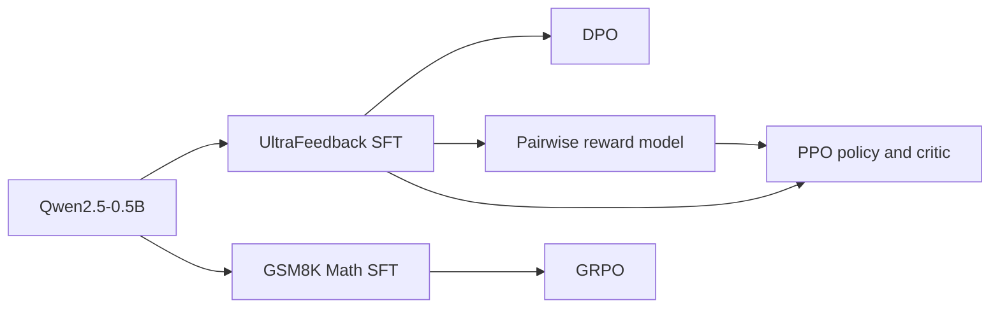
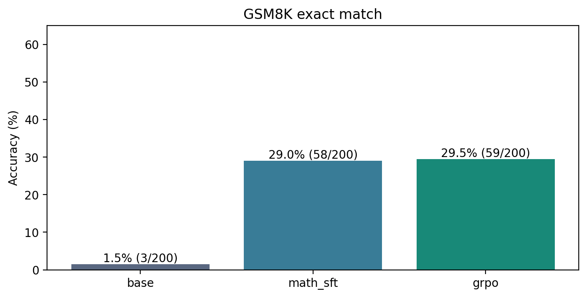

# Qwen2.5 Post-Training Lab

[中文说明](README_zh.md) · [Experiment report](docs/experiment_report.md) · [Implementation audit](docs/audit.md)

A single-GPU study of preference alignment and verifiable math rewards on Qwen2.5-0.5B. The strongest observed change came from supervised math demonstrations. On the same 200 GSM8K questions, GRPO subsequently gained seven correct answers and lost six.



| Model | Held-out preference pairs | GSM8K greedy exact match |
|---|---:|---:|
| Base | 24/51 | 3/200 |
| SFT | 25/51 | N/A |
| DPO | 25/51 | N/A |
| PPO | 25/51 | N/A |
| Math SFT | N/A | 58/200 |
| GRPO | N/A | 59/200 |



**What was trained.** Rank-8 PEFT adapters target the attention projections. TRL handles completion-only SFT, pairwise reward learning, DPO and GRPO. The PPO loop implements tokenwise reference penalties, terminal learned rewards, GAE, clipped updates and a value head. Data preparation samples 512 UltraFeedback pairs and 1,024 GSM8K training questions with seed 42. Each training branch uses its own merged SFT checkpoint.

**What the scores measure.** Preference ranking compares average response-token log likelihood. All three tuned policies made identical binary decisions on 51 validation pairs. The saved PPO adapter had zero LoRA B weights. The revised PPO code checks policy gradients, and awaits a fresh run. Math evaluation uses the first 200 official test questions, a required answer marker and a 128-token limit. The base model missed the marker on 195 examples. These measurements combine answer formatting, completion length and arithmetic.

## Reproduce

Start from a clean project copy. Historical scripts write to fixed data and output paths. Create an environment with `python -m venv .venv`. Activate with `.\.venv\Scripts\Activate.ps1` on Windows or `source .venv/bin/activate` on Linux. Install a driver-compatible PyTorch first. The recorded GPU was an RTX 3060 Laptop (6 GiB), running PyTorch 2.5.1+cu121. Linux ROCm uses PyTorch’s CUDA device interface and remains untested here. [PyTorch installation](https://pytorch.org/get-started/locally/)

Run these commands from the project root in either shell. Omit the adapter for a merged baseline, use Qwen/Qwen2.5-0.5B for Base, and select the PPO adapter on the preference SFT base for PPO. Use a distinct evaluation output for each model.

```sh
python -m pip install -r requirements.txt
python -m scripts.check_hardware
python -m scripts.prepare_data --n-pref 512 --n-math 1024 --seed 42
python -m scripts.train_sft --steps 80
python -m scripts.merge_adapter
python -m scripts.train_reward --steps 60
python -m scripts.train_dpo --steps 60
python -m scripts.train_ppo --steps 30 --max-new 64
python -m scripts.train_math_sft --steps 80
python -m scripts.merge_adapter --adapter outputs/math_sft_adapter --out outputs/math_sft_merged
python -m scripts.train_grpo --steps 30 --max-new 64
python -m scripts.evaluate_preference --model outputs/sft_merged --adapter outputs/dpo_adapter --limit 51 --out results/new_dpo.json
python -m scripts.evaluate --model outputs/math_sft_merged --adapter outputs/grpo_adapter --limit 200 --max-new 128 --out results/new_grpo.json
python -m scripts.plot_summary
python -m pytest -q
```

**Layout.** `scripts/` contains training, merge, evaluation and figure entry points. `src/` contains model setup, metrics, monitoring and PPO advantage estimation. `tests/` contains CPU checks. `results/evidence/` contains numeric logs and paired evaluation IDs. `results/figures/` contains the rendered comparisons. Data and model weights are generated locally.

**Next experiments.** Verify a nonzero PPO parameter delta after one update, evaluate the RM on a fresh preference split, and vary the GRPO generation budget under paired evaluation. The report lists run costs and historical versus revised settings.

[Qwen2.5](https://huggingface.co/Qwen/Qwen2.5-0.5B) · [UltraFeedback pairs](https://huggingface.co/datasets/trl-lib/ultrafeedback_binarized) · [GSM8K](https://huggingface.co/datasets/openai/gsm8k) · [TRL](https://github.com/huggingface/trl) · [PEFT](https://github.com/huggingface/peft) · [InstructGPT](https://arxiv.org/abs/2203.02155) · [DPO](https://arxiv.org/abs/2305.18290) · [PPO](https://arxiv.org/abs/1707.06347) · [DeepSeekMath](https://arxiv.org/abs/2402.03300)
