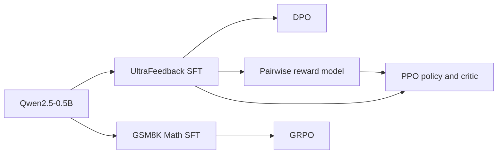
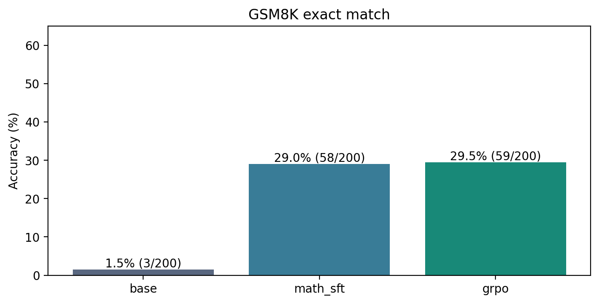

# Qwen2.5 单卡后训练实验

[English](README.md) · [实验报告与成本表](docs/experiment_report.md) · [代码审查](docs/audit.md)

在 6 GiB RTX 3060 Laptop 上，以 Qwen2.5-0.5B 为起点比较两类目标：从给定的偏好回答中学习排序，以及根据可验证答案优化数学任务。TRL 负责 SFT、RM、DPO、GRPO；项目中自行实现 PPO 的采样、逐 token 奖励、GAE、策略裁剪和价值头更新。



|模型|偏好验证集排序|GSM8K 测试子集|
|---|---:|---:|
|Base|24/51|3/200|
|SFT|25/51|N/A|
|DPO|25/51|N/A|
|PPO|25/51|N/A|
|Math SFT|N/A|58/200|
|GRPO|N/A|59/200|



偏好数据由 512 对 UltraFeedback 拆分得到，评估时比较候选回答平均 token 对数似然。PPO、DPO、SFT 逐对排序相同。检查保存张量发现 PPO 策略低秩增量为零，现已增加梯度检查，修订版本尚待训练验证。数学训练与验证共取 GSM8K train 的 1,024 题；测试取官方 test 前 200 题，使用 greedy 和 128 token 上限。Math SFT 净增 55 题，GRPO 再净增 1 题。Base 有 195 个输出缺少可提取答案，结果包含格式学习的贡献。

## 复现

在干净副本中运行，训练入口使用固定的默认输出目录。先执行 `python -m venv .venv`。Windows PowerShell 用 `.\.venv\Scripts\Activate.ps1`，Linux 用 `source .venv/bin/activate`。按驱动安装匹配的 PyTorch；历史环境为 2.5.1+cu121。ROCm 依赖对应的 HIP 构建，当前无实机结果。以下模块命令通用于两种系统。[PyTorch 安装说明](https://pytorch.org/get-started/locally/)

```sh
python -m pip install -r requirements.txt
python -m scripts.check_hardware
python -m scripts.prepare_data --n-pref 512 --n-math 1024 --seed 42
python -m scripts.train_sft --steps 80
python -m scripts.merge_adapter
python -m scripts.train_reward --steps 60
python -m scripts.train_dpo --steps 60
python -m scripts.train_ppo --steps 30 --max-new 64
python -m scripts.train_math_sft --steps 80
python -m scripts.merge_adapter --adapter outputs/math_sft_adapter --out outputs/math_sft_merged
python -m scripts.train_grpo --steps 30 --max-new 64
python -m scripts.evaluate_preference --model outputs/sft_merged --adapter outputs/dpo_adapter --limit 51 --out results/new_dpo.json
python -m scripts.evaluate --model outputs/math_sft_merged --adapter outputs/grpo_adapter --limit 200 --max-new 128 --out results/new_grpo.json
python -m scripts.plot_summary
python -m pytest -q
```

评估 Base 时指定 Qwen/Qwen2.5-0.5B；评估 SFT 时直接读取对应分支的 merged 目录；评估 PPO 时在偏好 SFT 基座加载 ppo_adapter。各模型指定不同 --out。LoRA 作用于注意力四组投影，秩为 8。配置与训练超参由各入口及 --help 提供。

scripts/ 存放执行入口，src/ 为共享模型、日志和指标，tests/ 为轻量测试。results/evidence/ 提供数值来源，results/figures/ 存放图，docs/ 提供算法公式、异常定位与后续实验。建议优先验证 PPO 单步策略更新，再用独立偏好测试集与更长数学生成预算复查结论。

[Qwen2.5](https://huggingface.co/Qwen/Qwen2.5-0.5B) · [UltraFeedback pairs](https://huggingface.co/datasets/trl-lib/ultrafeedback_binarized) · [GSM8K](https://huggingface.co/datasets/openai/gsm8k) · [TRL](https://github.com/huggingface/trl) · [PEFT](https://github.com/huggingface/peft) · [InstructGPT](https://arxiv.org/abs/2203.02155) · [DPO](https://arxiv.org/abs/2305.18290) · [PPO](https://arxiv.org/abs/1707.06347) · [DeepSeekMath](https://arxiv.org/abs/2402.03300)
