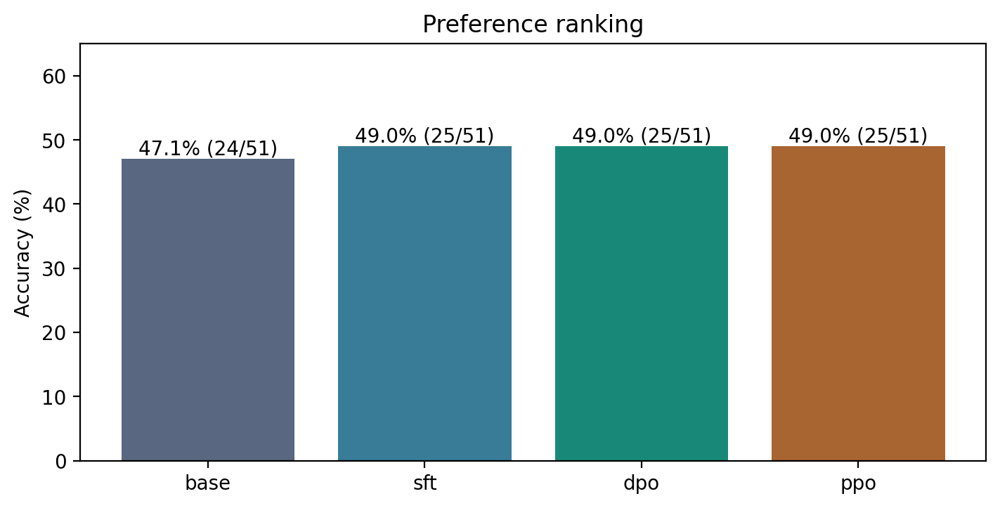
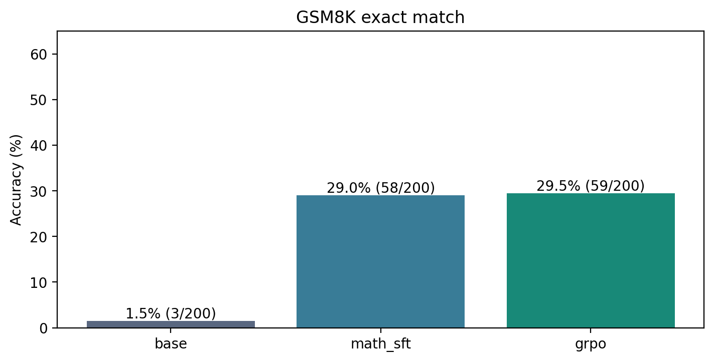
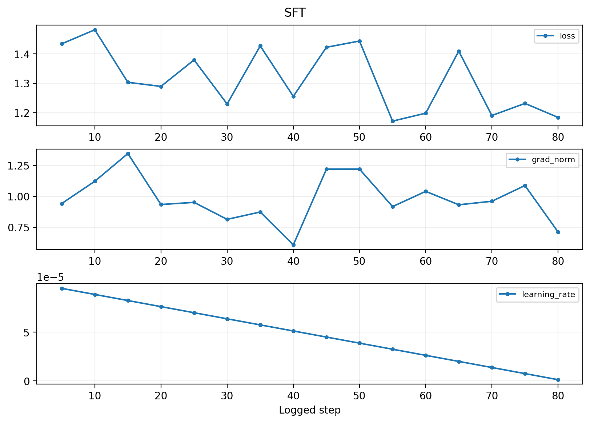
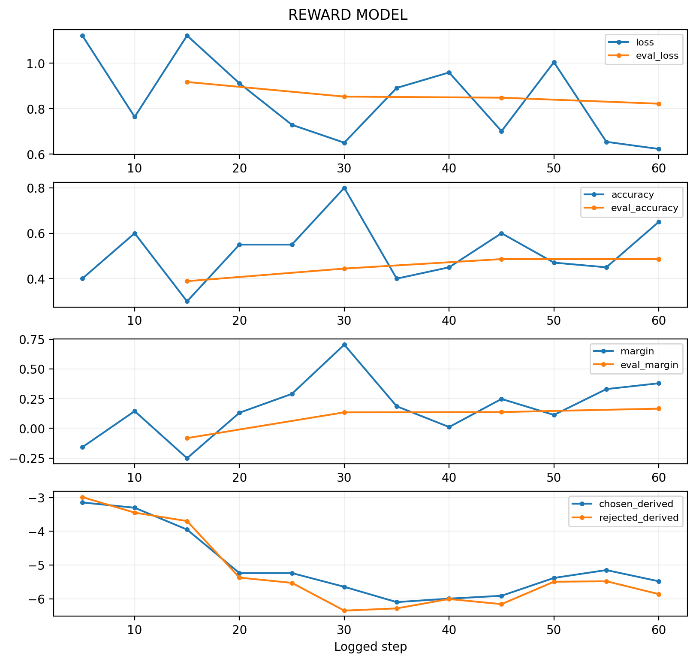
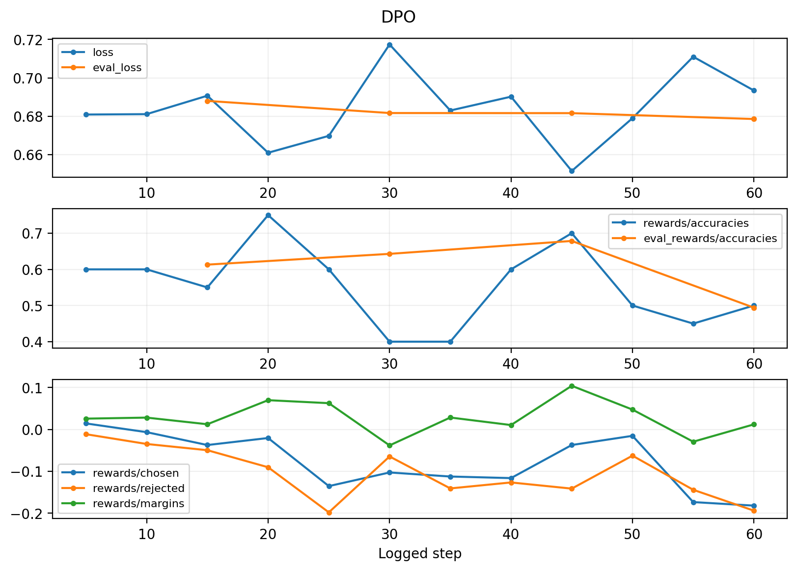
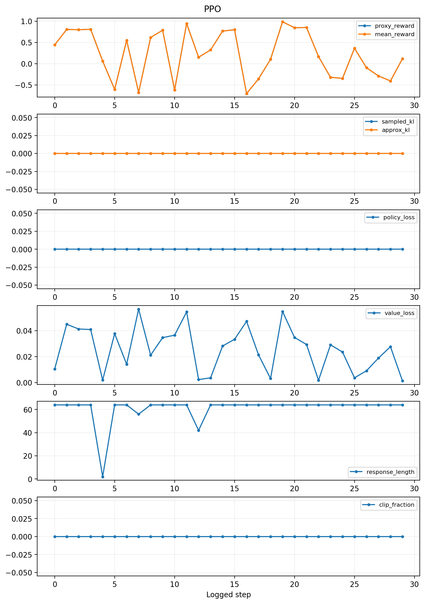
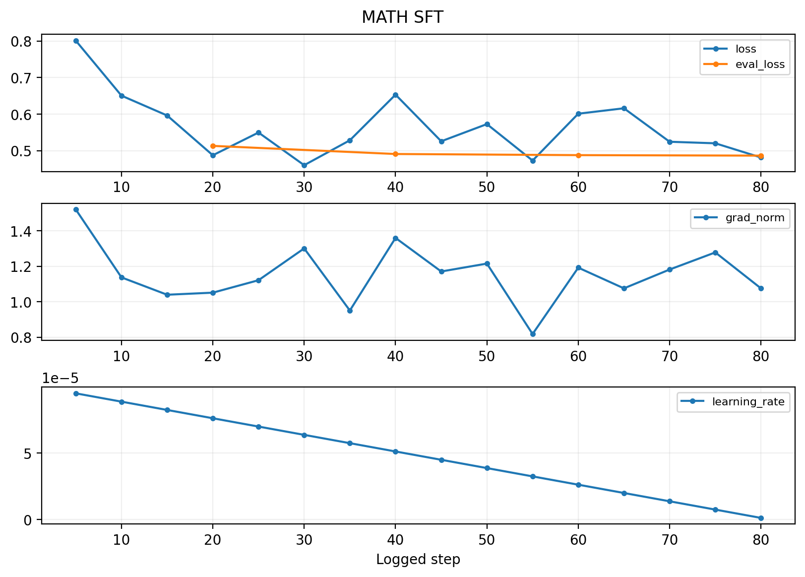
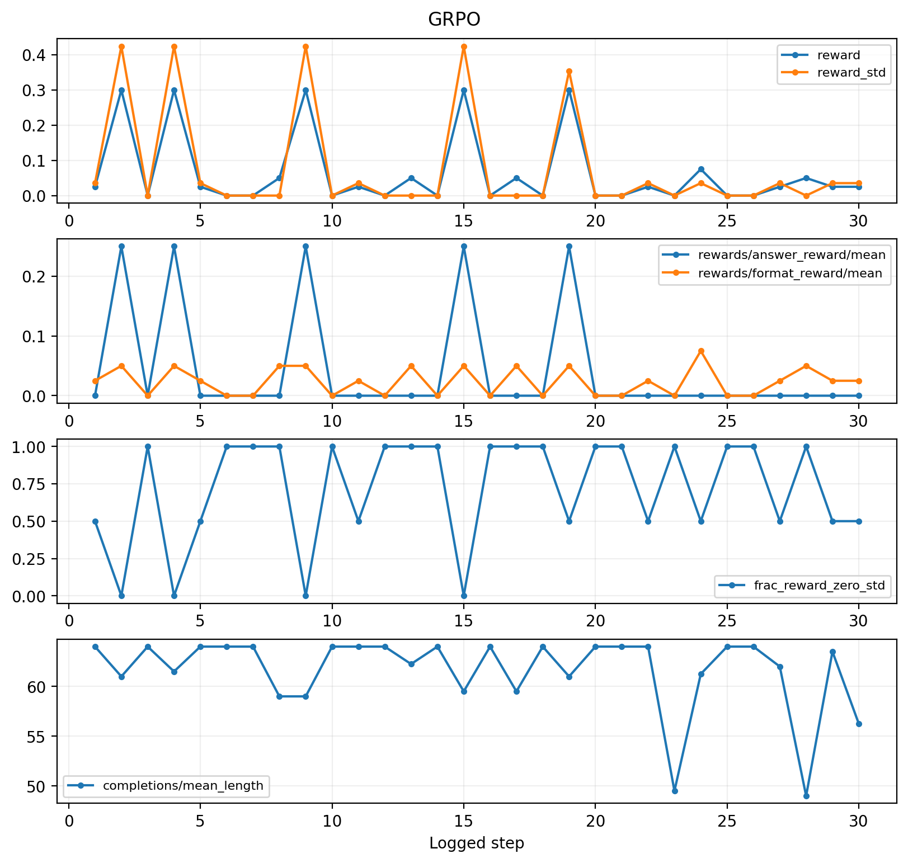
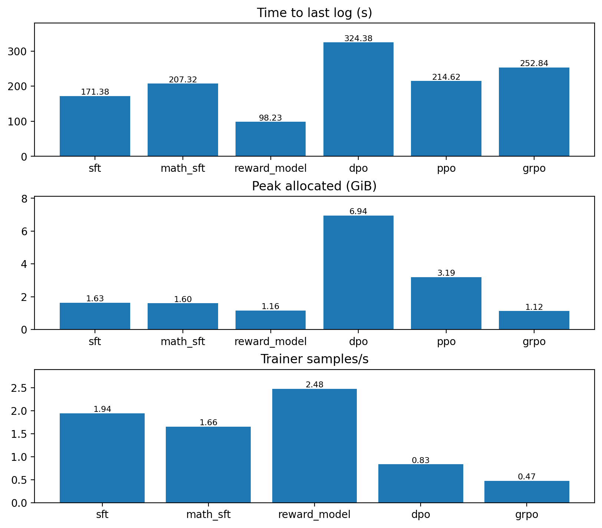

# Qwen2.5-0.5B 后训练实验报告

## 研究问题与对照

在 RTX 3060 Laptop 6 GiB、PyTorch 2.5.1+cu121 上，用同一基础模型分别研究示范学习、偏好优化、可验证奖励。训练日志记录 BF16 可用。两条分支分别以偏好 SFT 和数学 SFT 为对照。偏好数据来源于 trl-lib/ultrafeedback_binarized，偏好标签包含模型反馈；“RLHF”在这里指训练流程。

prepare_data.py 以种子 42 从上游训练集抽样，偏好 train/val 为 461/51，数学为 922/102。小写并去首尾空白后的完整数学题、偏好对话前缀，训练和验证的完全相同项各为 0。未测语义近重复或预训练污染。数学评估单独读取 GSM8K main test 前 200 题，所有模型均为 greedy、上限 128 token。偏好排序复用了训练期间监测的验证集；独立偏好测试结果 N/A。上游数据与模型 revision 尚未固定。

## 优化目标与实现边界

- **SFT**。train_sft.py 将 chosen 对话拆成 prompt 和最后的 assistant completion，TRL SFTTrainer 对 completion 上的下一 token 计算平均负对数似然。Math SFT 用去除计算器标记的解题过程和显式最终答案作示范。PEFT 在 Q/K/V/O 投影加入秩 8、alpha 16 的低秩更新。合并脚本读取 adapter 配置的基座，执行 merge_and_unload，再分别加载两条分支的合并权重。
- **RM**。train_reward.py 调用 RewardTrainer，通过 −log σ(r_chosen − r_rejected) 拟合偏好，保存 LoRA 及标量 score 层。奖励绝对值可整体平移；margin 的符号反映排序。日志记录成对奖励的总体均值及差值，可以用 mean ± margin/2 还原两侧均值。
- **DPO**。train_dpo.py 将成对回答交给 DPOTrainer。隐式奖励为 β(log π − log π_ref)，序列对数概率按回答累加；β=0.1，对 chosen/rejected 的隐式奖励差应用负 log-sigmoid。禁用新 adapter 得到冻结的 SFT 参考策略，无需加载训练好的 RM。
- **PPO**。train_ppo.py 自行采样并对齐位置 t−1 的 logits 与位置 t 的生成 token。逐 token 奖励为 −0.02(log π_old − log π_ref)，末 token 加 tanh(RM logit/5)。线性 value head 预测状态价值。GAE 从终点按 δ_t + γλA_(t+1) 递推，γ=1、λ=0.95；return 使用标准化之前的 advantage 加旧 value。策略损失使用概率比与 [0.8,1.2] 裁剪比值的较小 surrogate，价值损失回归 return。逐条轨迹标准化会消除绝对奖励尺度，单 token 的中心化优势为零。
- **GRPO**。train_grpo.py 用 GRPOTrainer 对同题采样两个回答。正确性奖励 1.0，能提取到显式数字答案再得 0.1。组内减均值并按奖励尺度归一化，无 critic。β=0，本次没有参考 KL 项，KL 指标 N/A。组内同奖时，相对优势为零。

## 偏好排序与数学评估

|模型|偏好选中 chosen|GSM8K 命中|未提取答案|达到 128 token|
|---|---:|---:|---:|---:|
|Base|24/51 (47.06%)|3/200 (1.5%)|195|189|
|SFT|25/51 (49.02%)|N/A|N/A|N/A|
|DPO|25/51 (49.02%)|N/A|N/A|N/A|
|PPO|25/51 (49.02%)|N/A|N/A|N/A|
|Math SFT|N/A|58/200 (29.0%)|25|43|
|GRPO（G=2）|N/A|59/200 (29.5%)|30|47|

偏好脚本对每个回答取平均条件 log-likelihood，长序列仅保留末 512 token。两个候选长度不同时可能保留不同数量的上下文。SFT 比 Base 多 1 对，即 +1.96 个百分点、相对 +4.17%；DPO/PPO 相对 SFT 净增 0。此度量只比较已有回答，无法评价自由生成的人类偏好胜率。

Math SFT 比 Base 提升 27.5 个百分点，相对 +1833.3%，极低的基线放大了相对数。GRPO 比 Math SFT 提升 0.5 个百分点，相对 +1.72%。平均生成长度依次为 125.74、88.86、89.27 token。Base 只有 5 个输出能提取答案，故分数同时反映算术、指令遵循与长度预算。达到上限只是截断风险。要分离这三者，可冻结同一批输出人工核查解析失败样本，并在相同题目上提高三组模型的生成上限。单种子、固定前缀抽样不足以据此判断总体优劣。

## 训练动态与成本

|阶段|步数|监控耗时 s|峰值 allocated GiB|Trainer samples/s|可训练参数（按保存张量及头结构）|
|---|---:|---:|---:|---:|---:|
|SFT|80|173.02|1.63|1.943|1,081,344|
|RM|60|98.75|1.16|2.478|1,082,240|
|DPO|60|324.72|6.94|0.835|1,081,344|
|PPO|30 轨迹|214.97|3.19|N/A|1,081,344 + 897|
|Math SFT|80|210.97|1.60|1.656|1,081,344|
|GRPO（G=2）|30|253.16|1.12|0.475|1,081,344|

监控耗时取 run_metadata 的 duration_seconds。成本图显示截至最后一次日志的时间。吞吐量沿用各 Trainer 定义，偏好对、数学样例及在线采样的工作量不同。DPO 的 allocator 读数超过硬件标称 6 GiB，应复核 Windows 共享内存与驱动记账；当前记录不足以解释差额，也不能用作最低物理显存要求。显存优化包括冻结主干、小批量、梯度累积、梯度检查点与限制序列长度，未做独立的显存节省比例消融。

- SFT 训练损失首末 1.4345 → 1.1842，梯度范数 0.942 → 0.712，末次记录学习率 1.25e−6。验证 token accuracy 从 0.5549 到 0.5588，但输出元数据中的 eval_loss 为 NaN。384 token 窗口下，训练 58 条、验证 8 条 prompt 单独就用尽预算；全遮罩可产生 NaN。缺失有限验证损失，不能判定过拟合。Math SFT 的训练损失 0.8009 → 0.4818，验证损失 0.5135 → 0.4869。
- RM 训练损失 1.1224 → 0.6229，训练 margin −0.159 → 0.3795。最后验证损失 0.8221、margin 0.166、Trainer accuracy 0.4861。其实现对各批次的准确率取均值，尾批大小不同；不应换算为 51 对中的正确条数。当前奖励模型的泛化证据弱。
- DPO 训练损失 0.6809 → 0.6934，训练隐式奖励准确率 0.60 → 0.50。chosen 奖励 0.0143 → −0.1817，rejected −0.0114 → −0.1938。两侧末值均负，差值仍为正。验证损失 0.6880 → 0.6786；验证隐式 margin 为 0.0357，没有表现为外部排序的净收益。
- PPO 平均轨迹回报 0.2285，代理奖励均值同为 0.2285；policy loss、sampled KL、approx KL 和 clip fraction 在日志精度下为零，value loss 均值 0.0256。标准化后 advantage 均值约 0、标准差约 1。保存的所有 LoRA B 张量绝对值最大值为 0，策略低秩增量为零。价值头可更新并不能证明策略已学习。30 次中有 27 次长度达到 64，entropy N/A。缺少策略改进及独立奖励证据，不能诊断为奖励投机。
- 首次 GRPO（G=2）训练生成上限只有 64，平均长度 61.61；clipped_ratio 均值 84.17%。平均 reward 0.065，其中正确性 0.0417、格式 0.0233。平均组内奖励标准差 0.0778，零方差组占 71.67%。只有少数组提供方向信号。优先在固定样本和采样预算下比较更长生成与更大组大小，并报告每生成 token 得到的非零优势数。

原始评估 JSON、CSV/JSONL、六组 TensorBoard 事件和 adapter 保留在本地。公开版保留数值日志与逐题命中 ID，图表由 scripts/plot_summary.py 重建。代码修订及其验证范围见 [审查记录](audit.md)。

## GRPO 采样数消融

固定 Math SFT 合并基座、种子 42、学习率 2e−5、β=0 和每步 4 个回答。两次运行均采用历史答案解析器及 TRL 0.26.2 默认损失，训练生成上限 64 token；测试沿用同一提示、贪心解码、128 token 上限及相同的 200 题。公开训练入口保留了历史奖励和优化目标。复跑时显式指定 --max-new 64、--num-generations 以及新的 --out。

|指标|G=2|G=4|
|---|---:|---:|
|优化步数 / 生成回答数|30 / 120|30 / 120|
|有效组数 / 尝试组数|17/60|18/30|
|零奖励方差组比例|71.67%|40.00%|
|未正常结束的生成比例|84.17%|76.67%|
|梯度范数非零的步数|13/30|18/30|
|采样生成 token|7,393|7,267|
|监控耗时（秒）|253.16|259.80|
|峰值分配（GiB）|1.119|1.117|
|GSM8K 严格命中|59/200|59/200|

以总奖励的组内方差是否大于零判断有效组。相同回答预算下，G=4 每组观察到的样本更多，组数减半，有效组仅净增 1 个。逐题核对命中 ID，G=4 相对 G=2 新增 7 题、丢失 7 题；相对 Math SFT 新增 6 题、丢失 5 题。单种子和有限样本不足以推断两种设置在总体上等效。下一步可固定 G=4 检验更长的生成预算，此处只报告已完成的两个历史实验。

[对照图](../results/figures/grpo_g2_g4.png) · [汇总数据](../results/evidence/grpo_g2_g4.csv) · [G=2 日志](../results/evidence/grpo.csv) · [G=4 日志](../results/evidence/grpo_g4_metrics.csv) · [首次评估命中 ID](../results/evidence/evaluations.json) · [G=4 评估命中 ID](../results/evidence/grpo_g4_eval.json)
